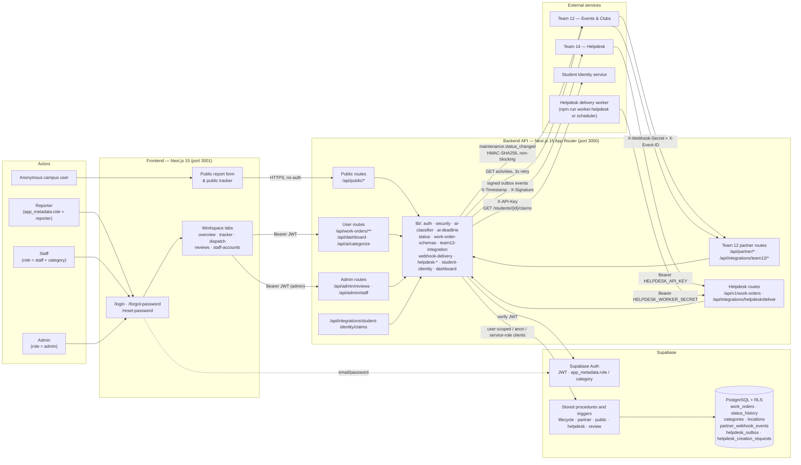
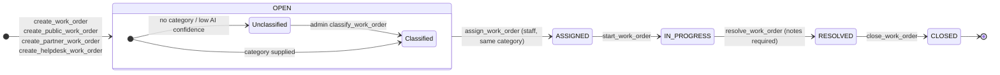
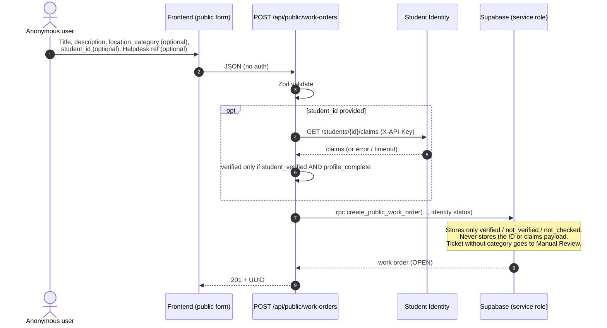
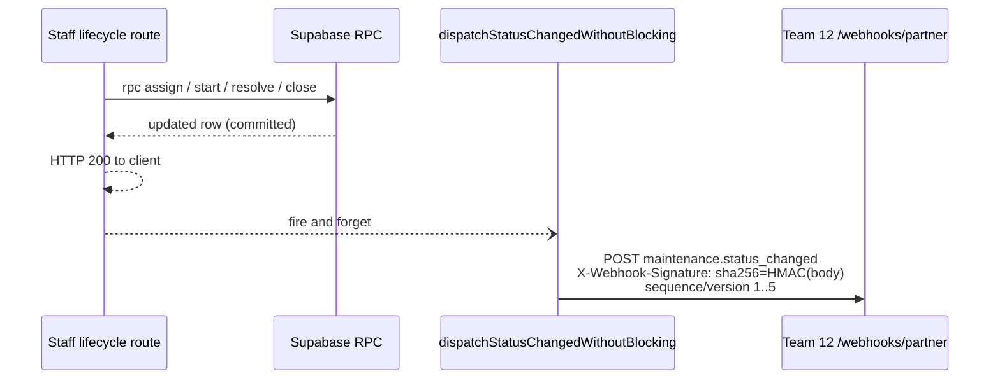
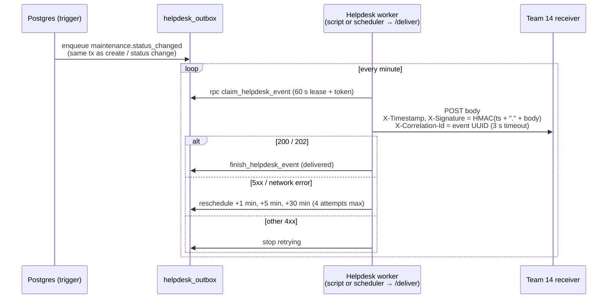

# System Architecture — Campus Facility Maintenance Platform (Team 10)

**Updated:** 10 November 2026 (reflects `main` at `738f383`, migrations `001`–`018`)

This replaces the earlier block diagram in [`platform-architecture.md`](platform-architecture.md) and [`../architecture.md`](../architecture.md). Since that version the platform has added:

- an anonymous public reporting path
- an `admin` role with manual category review and staff account management
- category-scoped `staff` accounts
- Student Identity claims checks
- the Team 14 Helpdesk integration (direct creation, lookup, and a signed outbox worker)

The old diagram also listed "Notification Hub" and "Analytics" as webhook consumers. Neither exists. The real outbound consumers are Team 12 (Events & Clubs) and Team 14 (Helpdesk).

---

## 1. System Context

---

## 2. Trust Boundaries and Authentication

Each route group has exactly one way to authenticate. Roles and staff categories come only from administrator-controlled `app_metadata`, never from `user_metadata`.

| Boundary | Routes | Credential | Guard | Supabase client |
|---|---|---|---|---|
| Public | `GET /api/public/metadata`, `GET/POST /api/public/work-orders`, `POST /api/public/categorize` | None | Zod validation; text redaction in SQL | anon (`supabase-public`) for reads; service role for `create_public_work_order` |
| Reporter | `GET/POST /api/work-orders`, `GET /api/work-orders/{id}`, `/history`, `/api/dashboard`, `/api/ai/categorize` | Bearer JWT | `requireAuth(req, [...])` | user-scoped (RLS applies) |
| Staff | `/assign`, `/in-progress`, `/start`, `/resolve`, `/close`, `PATCH/DELETE /api/work-orders/{id}`, `/submitters`, `/api/integrations/team12/activities` | Bearer JWT, `role = staff` **and** an assigned `category` | `requireAuth(req, ['staff'])`; returns 403 `CATEGORY_REQUIRED` / `CATEGORY_NOT_ALLOWED` | user-scoped (RLS limits staff to their category) |
| Admin | `/api/admin/reviews` (manual review), `/api/admin/staff` (create and update staff accounts) | Bearer JWT, `role = admin` | `requireAuth(req, ['admin'])` | user-scoped; `auth.admin` (service role) for account management |
| Staff / Admin | `POST /api/integrations/student-identity/claims` | Bearer JWT | `requireAuth(req, ['staff','admin'])` | n/a |
| Team 12 | `/api/partner/work-orders` (POST/GET/PATCH/DELETE), `/api/partner/health` | `X-Partner-Key` | `requirePartnerAuth` (`timingSafeEqual`) | service role, `partner_source = team12` RPCs |
| Team 12 webhook | `POST /api/integrations/team12/webhook` | `X-Webhook-Secret`, `X-Event-ID` | constant-time compare; dedupe on event ID | service role → `partner_webhook_events` |
| Team 14 Helpdesk | `POST /api/v1/work-orders`, `GET /api/v1/work-orders/{id}` | Bearer `HELPDESK_API_KEY`, `X-Correlation-Id` | `authorizeHelpdesk` (`secretsMatch`) | service role → `create_helpdesk_work_order` |
| Internal worker | `GET /api/integrations/helpdesk/deliver` | Bearer `HELPDESK_WORKER_SECRET` | `secretsMatch` | service role → `claim_helpdesk_event` / `finish_helpdesk_event` |
| Health | `GET /api/health` | None | none | none |

---

## 3. Work-Order Lifecycle (with Manual Review Gate)

- Transitions are forward-only. They are enforced in `lib/status.ts` (`isAllowedTransition`) and in the `enforce_status_transition` trigger.
- An unclassified ticket cannot be assigned (`require_classified_work_order`). Admins classify it via `/api/admin/reviews`. `validate_assignment` (migration 018) ensures the technician's category matches the ticket.
- Every state change writes `status_history` in the same transaction. History is immutable, and work orders are only soft-archived (`archived_at`).
- Tagged tickets fan out on every transition: Team 12 via a direct non-blocking webhook, and Helpdesk via the transactional outbox (section 5).

---

## 4. Request Flow — Public Report with Identity Check

---

## 5. Outbound Integrations

### 5.1 Team 12 — direct, non-blocking webhook

A delivery failure never rolls back the database change.

### 5.2 Team 14 Helpdesk — transactional outbox

Helpdesk status vocabulary: `OPEN→reported`, `ASSIGNED→assigned`, `IN_PROGRESS→in_progress`, `RESOLVED→completed`, `CLOSED→closed`. Delivery is gated by `HELPDESK_DELIVERY_ENABLED`.

### 5.3 Inbound summary

| Partner | Direction | Mechanism | Idempotency |
|---|---|---|---|
| Team 12 | in | `/api/partner/work-orders` create, lookup, modify, cancel | `activity_id` / `idempotency_key` (unique index + tx lock) |
| Team 12 | in | `/api/integrations/team12/webhook` | `X-Event-ID` in `partner_webhook_events` |
| Team 12 | out | `GET` activities with retry `[0, 1000, 2000] ms`; stale cache + `Retry-After: 30` | n/a |
| Team 14 | in | `POST /api/v1/work-orders` direct creation | `ticketRef` via `helpdesk_creation_requests` (retry returns 200 with the original) |
| Team 14 | in | `GET /api/v1/work-orders/{id}` minimal lookup (id, status, ticketRef, updatedAt) | read-only |
| Student Identity | out | `GET /students/{id}/claims` | read-only; three-state result |

---

## 6. AI Categorization Path

`POST /api/ai/categorize` (authenticated) and `POST /api/public/categorize` (public) both use `lib/category-suggestion.ts`. That module runs:

1. **Prompt-injection interceptors.** Regex checks run first. On a match the result is `fallbackToManual: true` with `decision_method: "Prompt-Defense"`.
2. **Grounded keyword classifier.** `ai-classifier.ts` and `classifier-matching.ts` match English and Thai terms against the MFU building hints. Water near electrical equipment escalates the category to `Safety`.
3. **The 1500 ms deadline.** `ai-deadline.ts` enforces it, and a confidence gate requires at least 0.40.
4. **Manual fallback.** Any failure routes to the manual dropdown, or, for public and Helpdesk tickets with no category, to admin Manual Review.

The detailed decision-engine diagram is in [`decision-model-integration.md`](decision-model-integration.md).

---

## 7. Deployment View

| Component | Runtime | Key configuration |
|---|---|---|
| Frontend | Next.js 15, port 3001 | `NEXT_PUBLIC_API_BASE_URL`, `NEXT_PUBLIC_SUPABASE_URL`, `NEXT_PUBLIC_SUPABASE_ANON_KEY` |
| Backend API | Next.js 15, port 3000 | `SUPABASE_SERVICE_ROLE_KEY`, `FRONTEND_ORIGINS` (CORS), `TEAM10_*`, `TEAM12_*`, `HELPDESK_*`, `STUDENT_IDENTITY_API_KEY` |
| Helpdesk worker | `npm run worker:helpdesk`, Windows scheduled task, or external cron → `/deliver` | `HELPDESK_WORKER_URL`, `HELPDESK_WORKER_SECRET`, `HELPDESK_DELIVERY_ENABLED` |
| Database | Hosted Supabase Postgres | Apply migrations `001`–`018` in order |
| CI | GitHub Actions | typecheck, `npm audit`, AI golden dataset, unit and security suites |

Secrets live only in untracked `.env.local` files (see `backend/.env.example`). The frontend never receives service-role, partner, Helpdesk, worker, or Student Identity keys.
